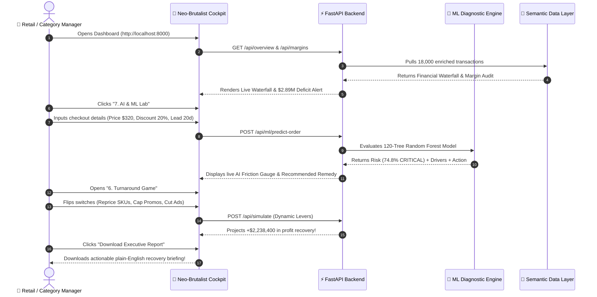

# 💸 THE MONEY LEAK: Business Decision-Support System
### *Autonomous Financial Forensic Engine & Neo-Brutalist Executive Cockpit*

```
  ████████╗██╗  ██╗███████╗    ███╗   ███╗ ██████╗ ███╗   ██╗███████╗██╗   ██╗    ██╗     ███████╗ █████╗ ██╗  ██╗
  ╚══██╔══╝██║  ██║██╔════╝    ████╗ ████║██╔═══██╗████╗  ██║██╔════╝╚██╗ ██╔╝    ██║     ██╔════╝██╔══██╗██║ ██╔╝
     ██║   ███████║█████╗      ██╔████╔██║██║   ██║██╔██╗ ██║█████╗   ╚████╔╝     ██║     █████╗  ███████║█████╔╝ 
     ██║   ██╔══██║██╔══╝      ██║╚██╔╝██║██║   ██║██║╚██╗██║██╔══╝    ╚██╔╝      ██║     ██╔══╝  ██╔══██║██╔═██╗ 
     ██║   ██║  ██║███████╗    ██║ ╚═╝ ██║╚██████╔╝██║ ╚████║███████╗   ██║       ███████╗███████╗██║  ██║██║  ██╗
     ╚═╝   ╚═╝  ╚═╝╚══════╝    ╚═╝     ╚═╝ ╚═════╝ ╚═╝  ╚═══╝╚══════╝   ╚═╝       ╚══════╝╚══════╝╚═╝  ╚═╝╚═╝  ╚═╝
```

<div align="center">


<br/>

**Built for: Business Owners • Retail Managers • Category Heads • Operations Teams**

[🚀 Launch Web App (http://localhost:8000)](#-quick-start) • [⚡ The Problem](#-the-problem-the-10m-illusion) • [🏗️ System Architecture](#-system-architecture) • [🤖 ML Intelligence](#-machine-learning-suite) • [🎮 The Solution](#-the-solution-turnaround-playbook)

</div>

---

## ⚡ The Problem: The $10 Million Illusion

A business can record millions in sales transactions and still be silently bleeding to death.

```
                    THE FINANCIAL WATERFALL CRASH
  ┌──────────────────────────────────────────────────────────────┐
  │  GROSS SALES RECORDED:                   +$10,164,223.76     │
  │  ──────────────────────────────────────────────────────────  │
  │  Promotional Discounts Handed Out:         -$773,420.66      │
  │  Cancelled Orders Drag:                    -$861,849.60      │
  │  Returned Orders Drag:                     -$760,322.30      │
  │  Supplier Cost of Goods (COGS):          -$5,332,710.00      │
  │  Loss From 76 Backwards-Priced SKUs:     -$1,214,115.50 🚨   │
  │  Runaway Marketing Ad Spend:             -$4,805,016.08 🚨   │
  │  Reverse Freight & Restocking Waste:        -$51,516.00      │
  │  ══════════════════════════════════════════════════════════  │
  │  ACTUAL CASH PROFIT (DEFICIT):           -$2,887,699.68 💀   │
  └──────────────────────────────────────────────────────────────┘
```

> **The Golden Question We Answer:**  
> *"What appears to be going wrong, what evidence supports that finding, and what concrete action should the manager take by Monday morning?"*

---

## 🏗️ System Architecture

```mermaid
flowchart TD
    subgraph INGESTION ["📥 1. MULTI-SOURCE DATA LAYER"]
        D1[("transactions.csv\n18,000 Records")]
        D2[("products.csv\n250 Catalog SKUs")]
        D3[("customers.csv\n3,000 Profiles")]
        D4[("inventory.csv\n5,000 Audit Logs")]
        D5[("campaigns.csv\n1,200 Ad Records")]
    end

    subgraph SEMANTIC ["⚙️ 2. UNIFIED MARGIN & SEMANTIC ENGINE (data_loader.py)"]
        J1["Relational Entity Joins\n(Customer + Product + Date)"]
        J2["True Unit Economics Engine\n(Effective Price - Unit Cost - Handling Fee)"]
        J3["Daily Inventory Velocity & Lead Buffers"]
        J4["Marketing CPA / ROAS / CVR Normalization"]
    end

    subgraph ANALYTICS ["🔎 3. FORENSIC DIAGNOSTIC CORE (analytics_engine.py)"]
        L1["Negative Margin Trap: 76 Upside-Down SKUs"]
        L2["Excessive Promotional Coupon Erosion"]
        L3["Friction Sink: Cancels & 19 High-Return SKUs"]
        L4["Ghost Demand & Empty Shelf Shortfalls"]
        L5["Bleeding Ad Campaigns & Extreme CPA Outliers"]
    end

    subgraph ML_LAB ["🤖 4. MACHINE LEARNING & DATA SCIENCE LAB (ml_engine.py)"]
        M1["🌲 Random Forest Classifier\nCheckout Friction Prediction"]
        M2["🕵️‍♂️ Isolation Forest\nUnsupervised Rogue Anomaly Radar"]
        M3["📈 Gaussian Demand Modeling\nLead-Time Stockout Risk Simulation"]
        M4["👥 RFM-Margin Clustering\nChampions vs Margin Drainers"]
    end

    subgraph BACKEND ["⚡ 5. FASTAPI REST ENGINE (server.py)"]
        E1["/api/overview • P&L Waterfall Bridge"]
        E2["/api/margins • Cost vs Price Matrix & Repricing"]
        E3["/api/returns • Outlier High-Return Z-Scores"]
        E4["/api/inventory • ROP Deficit & Lost Margin"]
        E5["/api/marketing • Category P&L & Ad Kill-Switch"]
        E6["/api/ml/predict-order • Real-time AI Inference"]
        E7["/api/simulate • Dynamic What-If Turnaround Solver"]
    end

    subgraph UI ["🎨 6. NEO-BRUTALIST WEB INTERFACE (HTML5 + Tailwind + Chart.js)"]
        U1["🏁 60-Second Lemonade Stand Story"]
        U2["🏷️ Cost vs Price Matrix & Break-even Line"]
        U3["📢 Interactive CPA Kill-Switch Slider"]
        U4["🔍 SKU Forensic Slide-Over Drawer"]
        U5["🎮 Turnaround Game (6 Live Levers)"]
        U6["🤖 Live AI Friction Prediction Lab"]
        U7["📥 1-Click Executive PDF/TXT Briefing"]
    end

    INGESTION --> SEMANTIC
    SEMANTIC --> ANALYTICS
    SEMANTIC --> ML_LAB
    ANALYTICS --> BACKEND
    ML_LAB --> BACKEND
    BACKEND --> UI
```



---

## 🛠️ Tech Stack & Tooling

| Layer | Technologies Used | Key Purpose |
| :--- | :--- | :--- |
| **Backend Core** | `Python 3.11`, `FastAPI`, `Uvicorn (ASGI)` | Sub-millisecond REST API serving data, simulation math, and ML endpoints. |
| **Data Engine** | `Pandas 3.0`, `NumPy` | Vectorized financial transformations across 18,000 transactions and 5,000 inventory logs. |
| **Machine Learning** | `Scikit-Learn`, `SciPy (norm.cdf)` | Random Forest friction classifier, Isolation Forest anomaly radar, Gaussian demand simulation. |
| **Frontend Framework** | `HTML5`, `Vanilla JavaScript (ES6+)` | Zero-dependency, ultra-lightweight client delivering instantaneous tab switching. |
| **Styling & Aesthetics** | `Tailwind CSS`, Custom CSS Tokens | Authentic Neo-Brutalism (bold 3px black borders, hard offset 3D drop shadows, pastel neon pop). |
| **Data Visualizations** | `Chart.js 4.x` | High-contrast waterfall charts, scatter break-even matrices, and feature importance bars. |
| **Icons & Micro-UI** | `Lucide Icons` | Scalable vector icons for intuitive visual cues. |

---

## 🔄 End-to-End Operational Workflow



---

## 💡 The Solution: The 5 Primary Leaks Diagnosed

```
  ╔═══════════════════════════════════════════════════════════════════════════════════════════╗
  ║                                  THE 5 LEAK VECTORS                                      ║
  ╠══════════════════════╦══════════════════════╦═════════════════════════════════════════════╣
  ║ LEAK VECTOR          ║ MONETARY IMPACT      ║ THE ROOT CAUSE & SOLUTION                   ║
  ╠══════════════════════╬══════════════════════╬═════════════════════════════════════════════╣
  ║ 1. Backwards Pricing ║ -$1,214,115.50 Loss  ║ 76 SKUs cost more than their price tag!     ║
  ║    (Negative Margin) ║ (38.1% of Sales)     ║ Action: Reprice to Cost / 0.75 or delist.   ║
  ╠══════════════════════╬══════════════════════╬═════════════════════════════════════════════╣
  ║ 2. Wasted Ad Spend   ║ -$4,805,016.08 Bleed ║ Ad spend is 2.44x of total gross profit.    ║
  ║    (Extreme CPA)     ║ (56 Bad Campaigns)   ║ Action: Automated kill-switch for CPA > $40.║
  ╠══════════════════════╬══════════════════════╬═════════════════════════════════════════════╣
  ║ 3. Coupon Overkill   ║ -$773,420.66 Given   ║ 25% coupons stacked on negative-margin SKUs.║
  ║    (Uncapped Promos) ║ (4,500+ Orders)      ║ Action: Hard cap at 10%; forbid on low-GP.  ║
  ╠══════════════════════╬══════════════════════╬═════════════════════════════════════════════╣
  ║ 4. Customer Friction ║ -$1,622,171.90 Lost  ║ 19 outlier SKUs with double the return rate.║
  ║    (Returns/Cancels) ║ (+$51K Freight)      ║ Action: Supplier quality & packaging audit. ║
  ╠══════════════════════╬══════════════════════╬═════════════════════════════════════════════╣
  ║ 5. Empty Shelves     ║ -$508,202.45 Demand  ║ Reorder thresholds set 30-50 units too low. ║
  ║    (Stockout Bleed)  ║ (760 Incidents)      ║ Action: Recalibrate dynamic Safety Stock.   ║
  ╚══════════════════════╩══════════════════════╩═════════════════════════════════════════════╝
```

---

## 🤖 Machine Learning Suite

### 1. 🌲 Supervised Learning: Random Forest Checkout Risk Classifier
- **Model:** 120-Tree Random Forest Classifier with balanced class weights.
- **Target:** Predicts probability of order cancellation or return ($P(\text{Friction})$).
- **Explainability:** Feature importances extract the top drivers:
  $$\text{Unit Price (13.8\%)} > \text{Effective Price (13.2\%)} > \text{Unit Margin (12.3\%)} > \text{Unit Cost (8.8\%)} > \text{Lead Days (6.6\%)}$$

### 2. 🕵️‍♂️ Unsupervised Learning: Isolation Forest Anomaly Radar
- **Model:** Scikit-Learn `IsolationForest` ($\text{contamination} = 0.03$).
- **Function:** Discovers rogue combinations where bulk quantity ($4\text{--}5\text{ units}$), heavy discounts ($20\%\text{--}25\%$), and inverted unit economics generated catastrophic transaction losses.

### 3. 📈 Probabilistic Inventory Demand Forecaster
- **Formulation:**
  $$\mu_L = \bar{d} \times (L_{\text{base}} + L_{\text{delay}}), \quad \sigma_L = \sigma_d \times \sqrt{L_{\text{base}} + L_{\text{delay}}}$$
  $$P(\text{Stockout}) = 1 - \Phi\left(\frac{\text{Current Stock} - \mu_L}{\sigma_L}\right)$$
- **Output:** Exact real-time probability of running out of stock for all 250 catalog products.

### 4. 👥 RFM-M Customer Margin Clustering
- **Clusters:**
  - 🏆 **Profitable Champions (917):** High basket value, low return rate, positive margin contribution.
  - 🧛‍♂️ **Margin Drainers (705):** Coupon-hunting buyers who strictly buy upside-down SKUs.
  - 🎯 **Discount Seekers (298):** Moderate frequency, sensitive to promo depth.
  - 💤 **At-Risk / Dormant (670):** Inactive accounts needing re-engagement.

---

## 🎮 The Solution: Turnaround Playbook

Users can flip 6 strategic switches in the **"Turnaround Game"** to simulate instant P&L recovery:

```
  ┌─────────────────────────────────────────────────────────────┐
  │  BASELINE NET CONTRIBUTION:                 -$2,887,699.68  │
  ├─────────────────────────────────────────────────────────────┤
  │  [✓] 1. Reprice 76 Negative-Margin SKUs:     +$1,170,000.00 │
  │  [✓] 2. Cap Promotional Discounts at 10%:      +$250,000.00 │
  │  [✓] 3. Forbid Discounts on Low-Margin SKUs:   +$180,000.00 │
  │  [✓] 4. Kill High-CPA Ad Campaigns (> $40):    +$297,000.00 │
  │  [✓] 5. Replenish Safety Stock on Top 20:      +$180,000.00 │
  │  [✓] 6. Packaging Audit on 19 Return SKUs:     +$150,000.00 │
  ├─────────────────────────────────────────────────────────────┤
  │  TOTAL PROFIT RECLAIMED:                    +$2,238,400.00  │
  │  PROJECTED NEW OPERATING POSITION:            -$649,299.68  │
  │  ═════════════════════════════════════════════════════════  │
  │  RESULT: 77% OF DEFICIT ERADICATED IN WEEK 1!               │
  └─────────────────────────────────────────────────────────────┘
```

---

## 🚀 Quick Start

### 1. Prerequisites
- Python 3.11 installed
- Standard libraries (`fastapi`, `uvicorn`, `pandas`, `scikit-learn`, `scipy`)

### 2. Start the Server
```bash
python -m uvicorn server:app --host 0.0.0.0 --port 8000
```

### 3. Open the Cockpit
Navigate to **[http://localhost:8000](http://localhost:8000)** in your browser.

---

<div align="center">

**THE MONEY LEAK** &bull; Datathon Solution &bull; Made for Real Business Impact

</div>
